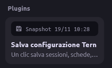

# Tern Snapshot

Plugin per [Tern](https://docs.stencil.so/tern/) su Windows: con un clic salva
tutte le sessioni della finestra (schede, split, file aperti, agenti omp) e, se
Tern le chiude, le ricostruisce.

Plugin non ufficiale, non affiliato a Stencil.



Il widget mostra quando hai salvato l'ultima volta. Un clic salva di nuovo.

## Installazione

In un pane di Tern:

```powershell
tern plugin install github.com/MrsKugla/tern-snapshot-plugin
```

Serve `git` nel `PATH`. `tern plugin list` deve mostrare
`tern-snapshot … window  ready`.

Poi aggiungi il widget alla barra, una volta sola:

1. Apri la palette dei comandi con Ctrl+Shift+P.
2. Scegli **Edit widgets…**.
3. Aggiungi **Salva configurazione Tern** dove vuoi nella barra.

## Aggiornamento

Tern non ha un comando di aggiornamento: si reinstalla con `--force`, che
sostituisce la copia installata.

```powershell
tern plugin install github.com/MrsKugla/tern-snapshot-plugin --force
```

Gli snapshot già salvati restano dove sono e il widget resta nella barra.

## Disinstallazione

```powershell
tern plugin remove tern-snapshot
```

Gli snapshot in `%LOCALAPPDATA%\Tern\plugin-data\tern-snapshot\` restano sul disco.

## Uso

### Salvare la configurazione

Clic sul widget **Snapshot**, oppure Ctrl+Shift+P → **Salva configurazione Tern**.

Il plugin:

1. salva i file con modifiche non salvate, così il loro contenuto non va perso;
2. scrive uno snapshot di tutte le sessioni della finestra;
3. mostra un avviso con quante sessioni, schede e blocchi ha salvato, e dove.

Terminali e agenti non vengono toccati: niente viene digitato né inviato.

Lancialo quando hai una disposizione che vuoi poter ritrovare, per esempio
prima di aggiornare Tern.

### Ripristinare

Ctrl+Shift+P → **Ripristina configurazione Tern**:

1. scegli lo snapshot dall'elenco: ogni voce mostra data, sessioni, schede e
   blocchi;
2. se una sessione con lo stesso nome esiste già, scegli se saltarla o crearla
   con il suffisso ` (ripristino)`;
3. il plugin ricrea le sessioni mancanti con schede, nomi, colori e split,
   riapre file, git, browser e board, e rilancia gli agenti omp sulla loro
   conversazione (`omp --resume`) nella loro cartella;
4. alla fine si apre una nota **Ripristino Tern** con quello che non è riuscito
   a ricreare.

Le sessioni che esistono già non vengono mai chiuse né modificate.

## Requisiti

- Windows 10/11, Tern 0.9.28 (testato).
- `omp` nel `PATH`, solo per rilanciare gli agenti.

## Limiti

- Lo snapshot copre la finestra da cui lo lanci.
- I terminali tornano come shell vuote nella loro cartella: il comando che
  stavano eseguendo non viene rilanciato, ma compare nel resoconto.
- I blocchi plugin si riaprono senza gli argomenti con cui erano stati aperti.
- I blocchi flottanti e parcheggiati vengono salvati ma non ricreati.
- I database con modifiche non si salvano (Tern ha solo "salva come").
- Un file, una cartella o un repository che non esiste più viene saltato, oppure
  la scheda si apre nella home, e compare nel resoconto.

## Dove sono i dati

| Cosa | Dove |
| --- | --- |
| Snapshot | `%LOCALAPPDATA%\Tern\plugin-data\tern-snapshot\snapshots\AAAA-MM-GG_HHMMSS.json` (gli ultimi 30) |
| Ultimo snapshot | `…\snapshots\latest.json` |
| Resoconti dei ripristini | `…\tern-snapshot\restores\` |

## Uso da Carly

Il ripristino si può lanciare senza scegliere dall'elenco: scrivi
`%LOCALAPPDATA%\Tern\plugin-data\tern-snapshot\restore-request.json` con
`{ "path": "<snapshot>.json", "mode": "skip" }` (oppure `"suffix"`), poi
`await(plugins["tern-snapshot"].restore())`.

## Sviluppo

```powershell
tern plugin link C:\percorso\tern-snapshot-plugin
tern plugin types C:\percorso\tern-snapshot-plugin   # tern.d.luau per luau-lsp
```

`tern plugin unlink tern-snapshot` scollega la cartella. Una copia installata e
una collegata con lo stesso id non possono convivere: prima di installare,
scollega.

| File | Contenuto |
| --- | --- |
| `plugin.toml` | Manifest |
| `window.luau` | Comandi, widget, salvataggio |
| `restore.luau` | Ripristino |
| `docs/widget.png` | Immagine del widget per il README |

## Licenza

MIT, vedi [LICENSE](LICENSE).
